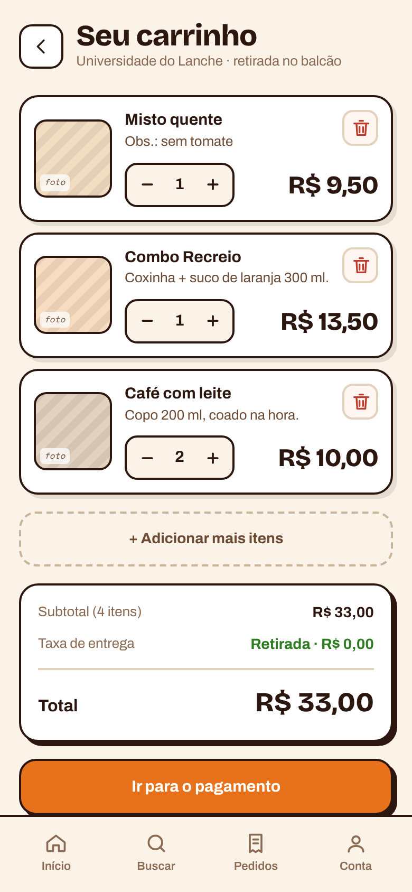
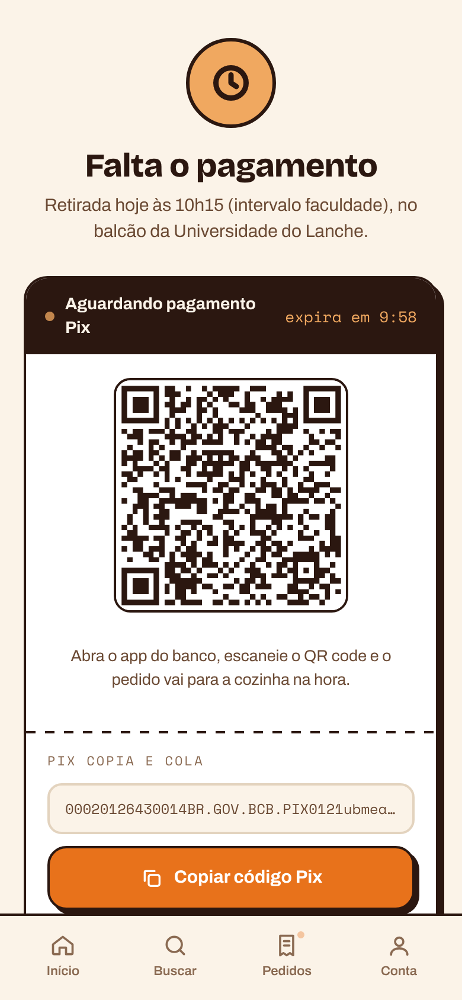
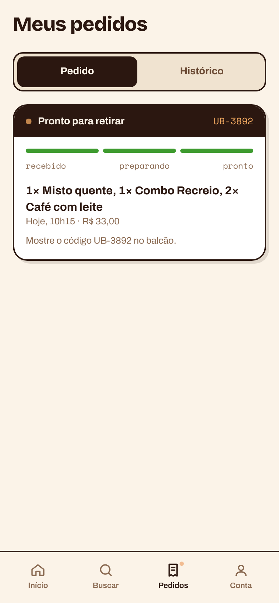

# UBMeal

Sistema web em que alunos, funcionários e responsáveis da UBM pedem e pagam o lanche da cantina pelo celular e só passam no balcão para retirar.

## Sobre o projeto

No intervalo, a fila da cantina consome boa parte do tempo livre de quem estuda e trabalha na UBM, e a cantina só descobre o que vai preparar quando o cliente chega ao balcão. Com o UBMeal, a pessoa vê o cardápio, monta o pedido, escolhe um horário de retirada ou entra na fila e paga por Pix, saldo pré-pago ou no balcão. A cantina recebe o pedido antes e o entrega pelo código de retirada (UB-XXXX). O saldo pré-pago só sobe depois que a cantina confere a recarga no app do banco. O sistema atende quatro perfis: aluno da faculdade, aluno do ensino fundamental ou médio, funcionário e pai, mãe ou responsável.

Parceiro extensionista: cantina Universidade do Lanche, no campus da UBM (Centro Universitário de Barra Mansa), em Barra Mansa (RJ).

## Tecnologias

| Tecnologia | Versão | Para que serve no projeto |
|---|---|---|
| HTML5, CSS3 e JavaScript puro (ES2017, sem framework) | padrão dos navegadores atuais | telas, estilos e toda a lógica do app, em uma página só (SPA) |
| Firebase JavaScript SDK (versão compat, via CDN) | 10.12.2 | conexão do app com os serviços do Firebase |
| Firebase Authentication (provedor Google) | 10.12.2 | login com a conta Google |
| Cloud Firestore | 10.12.2 (SDK) | banco de dados NoSQL em tempo real: contas, pedidos, códigos, recargas e equipe da cantina |
| Regras de segurança do Firestore | rules_version 2 | quem pode ler e alterar cada dado; também conferem preços, total, débito do saldo e ordem do status (arquivo `firestore.rules`) |
| Web Crypto API (PBKDF2 com SHA-256) | padrão dos navegadores atuais | guarda só o hash da senha de pagamento de 6 dígitos |
| qrcode (node-qrcode, via CDN) | 1.5.3 | QR Code do Pix |
| Google Fonts: Bricolage Grotesque, Archivo e Space Mono | — | tipografia da interface |
| Netlify | serviço de hospedagem | publicação do site |
| Node.js + pacote serve | Node 20 ou mais novo · serve 14.2.7 | servidor local para rodar o projeto no computador (só no desenvolvimento) |
| Firebase CLI (firebase-tools) + emulador do Firestore | 13.35.1 | roda os testes das regras no computador, sem tocar no banco de verdade (só no desenvolvimento) |
| @firebase/rules-unit-testing + Firebase JS SDK | 5.0.2 · 12.19.0 | biblioteca dos testes automatizados das regras (pasta `tests/`) |
| Java (JDK) | 11 ou mais novo | exigido pelo emulador do Firestore (só para rodar os testes) |

O projeto não tem etapa de build: o navegador lê `index.html`, `style.css` e `script.js` direto, e as bibliotecas vêm da internet (CDN). As ferramentas de teste ficam no `package.json` e só são instaladas por quem for rodar os testes.

## Pré-requisitos

- Git — https://git-scm.com/downloads
  - Para conferir: `git --version`
- Node.js 20 LTS ou mais novo (usado só para subir o servidor local) — https://nodejs.org/pt
  - Para conferir: `node --version` (deve mostrar v20 ou maior)
- Google Chrome, Edge ou Safari atualizado, com acesso à internet (o Firebase e as bibliotecas vêm da internet)
- Uma conta Google para fazer login no app
- Só para rodar os testes automatizados: Java 11 ou mais novo — https://adoptium.net/pt-BR
  - Para conferir: `java -version`

## Instalação

1. Clone o repositório e entre na pasta:

   ```bash
   git clone https://github.com/luizhenri25/ubmeal-rev10.git
   cd ubmeal-rev10
   ```

2. Instale as dependências:
   - para **usar o app**, não há nenhuma: o Firebase e o gerador de QR Code são carregados pelo próprio `index.html`;
   - para **rodar os testes das regras**, rode uma vez:

     ```bash
     npm install
     ```

3. Banco de dados: não é preciso criar tabelas. O Cloud Firestore cria as coleções `usuarios`, `pedidos`, `codigos` e `recargas` sozinho na primeira gravação. Só a coleção `equipe` (contas da cantina) é criada à mão, como explica a seção [Configuração](#configuração).

## Configuração

O projeto não usa arquivo `.env` nem `.env.example`. Como é um site estático sem servidor próprio, a configuração do Firebase fica no início do `script.js`, no objeto `FIREBASE_CONFIG`.

Para rodar com o projeto Firebase da equipe, não é preciso mudar nada. O endereço `localhost` já vem autorizado no Firebase.

Por que essa configuração pode ficar no repositório: os valores do `FIREBASE_CONFIG` de um app web não são senhas. Eles só dizem ao navegador qual projeto Firebase usar e ficam visíveis para qualquer pessoa que abra o site. Quem protege os dados são as regras do arquivo `firestore.rules` e a lista de domínios autorizados no Firebase. Nenhuma senha, chave de serviço (service account) ou token de administrador vai para o repositório.

Para usar outro projeto Firebase (por exemplo, quando a cantina tiver o dela), troque os valores abaixo pelos do novo projeto, que ficam no Console do Firebase › Configurações do projeto › Seus apps › App da Web:

| Campo do `FIREBASE_CONFIG` | Obrigatório? | Exemplo (fictício) | Descrição |
|---|---|---|---|
| `apiKey` | Sim | `AIzaSyEXEMPLO-troque-este-valor` | identifica o app web no Firebase |
| `authDomain` | Sim | `meu-projeto.firebaseapp.com` | domínio usado pelo login com Google |
| `projectId` | Sim | `meu-projeto` | projeto onde fica o Cloud Firestore |
| `storageBucket` | Não | `meu-projeto.firebasestorage.app` | reservado; o app ainda não envia arquivos |
| `messagingSenderId` | Não | `000000000000` | reservado para notificações push |
| `appId` | Sim | `1:000000000000:web:abc123` | identificador do app web |

Num projeto Firebase novo, faça também, uma vez só:

1. Em Authentication › Método de login, ative o provedor **Google**.
2. Em Firestore Database, crie o banco e, na aba **Regras**, cole o conteúdo do arquivo `firestore.rules` e clique em **Publicar**.
3. Em Authentication › Configurações › **Domínios autorizados**, adicione o domínio onde o site será publicado (ex.: `ubmeal.netlify.app`).
4. Para cada pessoa da cantina, crie em Firestore Database o documento `equipe/{uid}` com o campo `papel` (`"caixa"`, `"preparo"` ou `"dono"`). O `uid` aparece em Authentication › Usuários depois que a pessoa entra no app pela primeira vez.

Se mudar o preço de um produto na constante `PRODUTOS` do `script.js`, mude também a função `precos()` do `firestore.rules` e publique as regras de novo: as regras conferem o preço de cada item e recusam o pedido se os dois estiverem diferentes.

## Como executar

Na pasta do projeto, rode:

```bash
npx --yes serve@14.2.7 -l 3000
```

Na primeira vez, o `npx` baixa o pacote `serve` (alguns segundos). Depois, o terminal mostra `Serving!` com o endereço `http://localhost:3000`; em alguns terminais a mensagem é `Accepting connections at http://0.0.0.0:3000`, que significa a mesma coisa. Se tudo estiver certo, o sistema estará disponível em: http://localhost:3000

Abra pelo endereço `localhost`, que já vem autorizado no Firebase. Se usar outro endereço, como o `127.0.0.1:5500` do Live Server do VS Code, confira antes se ele está em Authentication › Configurações › Domínios autorizados; senão o login com Google mostra o aviso de endereço não autorizado. Abrir o `index.html` com dois cliques (endereço começando com `file://`) não funciona, porque o login com Google exige um endereço `http://` ou `https://`.

Para parar o servidor, aperte `Ctrl + C` no terminal.

## Exemplo de uso

Fluxo principal: fazer um pedido pago com Pix e acompanhar até a retirada.

1. Em http://localhost:3000, toque em **Entrar com o Google** e escolha sua conta. No primeiro acesso, informe o nome e o tipo de usuário e toque em **Continuar para a cantina**.
2. No cardápio, toque em **+** nos produtos. Para escrever uma observação ("sem tomate"), abra o produto, preencha **Alguma observação?** e toque em **Adicionar**.
3. Abra o carrinho, ajuste as quantidades e toque em **Ir para o pagamento**.

   

4. Escolha **Escolher horário** (ou **Entrar na fila**), selecione **Pix na hora** e toque em **Confirmar pedido**. Aparecem o QR Code e o código copia e cola, com 10 minutos para pagar.

   

5. Depois de pagar no app do banco, toque em **Já fiz o pagamento**. O pedido vai para a conferência do caixa da cantina.
6. Em **Pedidos**, acompanhe o status. A tela muda sozinha quando a cantina confere o Pix e prepara o lanche. Quando aparecer **Pronto para retirar**, mostre o código UB-XXXX no balcão.

   

Enquanto o painel da cantina não fica pronto, a equipe faz a parte dela de um destes dois jeitos:

- **Pelo app (recomendado):** entre no app com a conta que está na coleção `equipe`, abra o console do navegador (F12 › Console) e rode `mudarStatusPedido('id-do-pedido', 'em_preparo')` (depois `'pronto'` e `'retirado'`) ou, para uma recarga de saldo, `conferirRecarga('id-da-recarga', true)`. Assim as regras conferem tudo, como vai acontecer no painel.
- **Pelo Console do Firebase:** Firestore Database › `pedidos` › documento do pedido › campo `status`, seguindo a ordem `em_preparo` → `pronto` → `retirado` e ajustando o campo `ativo` (`false` em `retirado`). O Console tem acesso de administrador e não passa pelas regras, então a ordem fica por conta de quem edita.

## Testes

### Testes automatizados das regras do Firestore

As regras de segurança (`firestore.rules`) têm testes automatizados em `tests/regras.test.mjs`. Eles sobem o emulador do Firestore no seu computador, gravam dados de teste e conferem o que as regras aceitam e recusam, sem tocar no banco de verdade. Com o Java instalado e depois do `npm install`, rode:

```bash
npm test
```

Na primeira vez, o Firebase CLI baixa o emulador (algumas dezenas de MB). O resultado esperado é o Node listar os testes com `ok` e terminar com `# fail 0`. Os testes cobrem:

- o aluno não consegue gravar o próprio saldo nem criar a conta já com saldo;
- pedido com preço diferente do cardápio, com total que não bate com a soma dos itens, com cartão ou com status inicial errado é recusado;
- pedido sem a reserva do código `UB-XXXX` no mesmo lote, ou com um código já usado no dia, é recusado;
- pedido pago com saldo só passa se o saldo for debitado no mesmo lote, com o valor exato e sem ficar negativo;
- a equipe só muda o status na ordem do ciclo (não pula etapas nem volta um pedido retirado) e o campo `ativo` precisa combinar com o status;
- a recarga só credita o saldo quando a equipe marca a recarga como conferida no mesmo lote, com o valor exato e uma vez só.

Rode os testes antes de publicar uma versão nova do `firestore.rules` no Console do Firebase.

### Teste manual da função principal

A interface ainda é testada à mão, assim:

1. Rode o projeto (seção [Como executar](#como-executar)) e entre com uma conta Google.
2. Adicione dois produtos, um deles com observação, e confira se o total do carrinho está certo.
3. Confirme um pedido com **Pix na hora**. No Console do Firebase, confira se apareceu um documento em `pedidos` com `status: "aguardando_pix"` e um código `UB-XXXX`.
4. Toque em **Já fiz o pagamento**. O `status` no Console deve mudar para `aguardando_conferencia`, e o código de retirada deve continuar escondido no app.
5. Com a tela **Pedidos** aberta, mude o `status` para `em_preparo` e depois para `pronto` (veja os dois jeitos em [Exemplo de uso](#exemplo-de-uso)). A tela do app deve mudar sozinha, sem recarregar, e mostrar o código.
6. Mude o `status` para `retirado`. O pedido deve sair de **Pedido** e aparecer em **Histórico**.
7. Em **Conta › Recarregar**, gere um Pix de R$ 20,00 e toque em **Já fiz o pagamento**. O saldo deve continuar igual, com o aviso "R$ 20,00 em conferência pela cantina". Com a conta da equipe, rode `conferirRecarga('id-da-recarga', true)`: o saldo do aluno deve passar para R$ 20,00 sozinho.
8. Faça um pedido com **Saldo UBMeal**. O app deve pedir a senha de pagamento de 6 dígitos (na primeira vez, criar a senha) e só então confirmar. No Console, o documento da conta deve mostrar `senhaPagHash`, nunca os 6 dígitos.

Resultado esperado: todos os passos acontecem como descrito, sem erros no console do navegador (F12 › Console).

## Estrutura do projeto

```
ubmeal-rev10/
├── img/                  # logos do UBMeal e da cantina Universidade do Lanche
├── docs/                 # documentação (manual técnico parcial)
│   └── img/              # prints e diagramas usados na documentação
├── tests/
│   └── regras.test.mjs   # testes automatizados do firestore.rules (npm test)
├── index.html            # estrutura de todas as telas (página única)
├── style.css             # estilos, pensados primeiro para o celular
├── script.js             # lógica: login, carrinho, pedidos, Pix, saldo e recargas
├── firestore.rules       # regras de segurança do Cloud Firestore
├── firebase.json         # configuração do emulador usado nos testes
├── package.json          # ferramentas de teste (só para desenvolvimento)
├── package-lock.json     # versões exatas das ferramentas de teste
├── .gitignore            # deixa node_modules e logs fora do repositório
├── LICENSE               # licença MIT
└── README.md
```

## Documentação complementar

- [Manual técnico parcial](docs/manual-tecnico-parcial.md): estrutura do banco de dados e regras de negócio
- [Diagrama das coleções do Firestore](docs/img/der-firestore.png)
- [Ciclo de vida do status do pedido](docs/img/fluxo-status-pedido.png)
- [Regras de segurança do Firestore](firestore.rules)

## Equipe e licença

| Integrante | Papel no projeto | GitHub |
|---|---|---|
| Gabriel Vicente | Documentação | [@usuario] |
| João Gabriel Gama | Firebase e regras de segurança | [@usuario] |
| Luiz Henrique Marques | Front-end | [@luizhenri25](https://github.com/luizhenri25) |
| Noan Escobar | Front-end e testes | [@NoanRodrigues](https://github.com/NoanRodrigues) |
| Thiago Araújo | Firebase, regras de segurança e testes | [@usuario] |

Todos os integrantes participaram do contato com a cantina parceira, apresentando a ideia ao dono da Universidade do Lanche.

Licença: MIT (arquivo [LICENSE](LICENSE)). A cantina parceira e as próximas turmas podem usar, modificar e continuar o sistema, mantendo o crédito da equipe.

Projeto desenvolvido na disciplina Práticas Extensionistas Integradoras III — Engenharia de Software, UBM, 2026.
