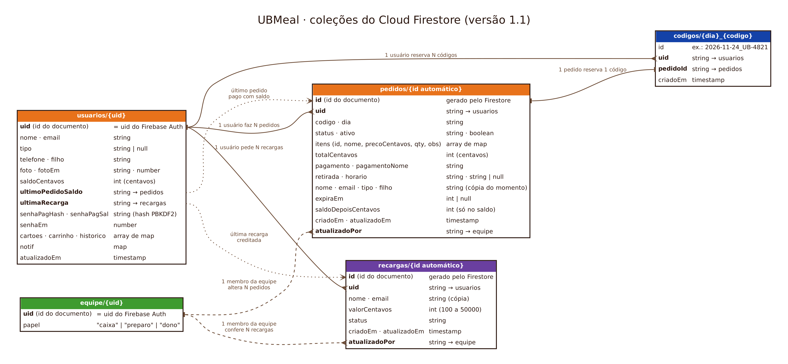

# Manual Técnico Parcial — UBMeal

Versão: 1.1 · Data: 24/11/2026 · Repositório: https://github.com/luizhenri25/ubmeal-rev10

O que mudou desde a versão 1.0 (10/11/2026): valores em dinheiro passaram a ser inteiros em centavos; o saldo só muda junto com um pedido pago com saldo ou com uma recarga conferida pela cantina (coleção nova `recargas`); as regras do Firestore passaram a conferir preço, total, débito do saldo, reserva do código e ordem do status; o pagamento com cartão pelo app foi desativado; a senha de pagamento passou a ser pedida em todo pagamento com saldo e a ser guardada só como hash; horários de retirada que já fecharam ficam bloqueados.

## 1. Público-alvo e tarefas

Este manual se destina a: desenvolvedor que vai assumir a manutenção do UBMeal no próximo período, ou integrante que entrar no grupo agora, e que vai começar pelo painel da cantina (telas do caixa e do preparo). A pessoa já sabe JavaScript e já rodou o projeto seguindo o [README](../README.md).

Ao final da leitura, essa pessoa deve conseguir:

- construir o painel da cantina lendo e alterando os documentos certos no Cloud Firestore, sem quebrar a ligação entre usuário, pedido, código de retirada e recarga (resolvida na seção 2)
- alterar o fluxo do pedido (status, Pix, saldo, retirada) ou o carrinho sem violar uma regra combinada com a cantina parceira (resolvida na seção 3)

## 2. Estrutura do banco de dados

### Visão geral

O UBMeal usa o **Cloud Firestore** (banco NoSQL do Firebase, SDK 10.12.2). No Firestore não há tabelas: os dados ficam em **coleções**, e cada coleção guarda **documentos** com campos. Este manual chama cada coleção de "tabela" para seguir o modelo da disciplina. São 5 coleções: `usuarios`, `pedidos`, `codigos`, `recargas` e `equipe`.

O app web conversa direto com o Firestore pelo SDK, sem API própria no meio. Por isso, quem decide o que cada pessoa pode ler e gravar é o arquivo `firestore.rules`, na raiz do repositório (ver RN12, RN13, RN14 e RN25 na seção 3). As regras têm testes automatizados em `tests/regras.test.mjs` (`npm test`, ver o README).

**Dinheiro em centavos.** Todo valor em dinheiro é um número inteiro em centavos: `1250` quer dizer R$ 12,50. Somar inteiros nunca dá `0,30000000000000004`, e as regras conseguem conferir o total exato do pedido. Os campos de dinheiro terminam em `Centavos` para ninguém confundir a unidade.

O cardápio ainda não está no banco: os produtos ficam na constante `PRODUTOS`, no `script.js`, e os mesmos preços ficam na função `precos()` do `firestore.rules`, que confere cada pedido. Levar o cardápio para uma coleção `produtos` é o item 12 do Product Backlog.

O diagrama abaixo está em `docs/img/der-firestore.png`.

#### Tabela usuarios

Guarda a conta, as preferências e o saldo de cada pessoa que entrou com o Google. Caminho: `usuarios/{uid}`.

| Campo | Tipo | Obrigatório | Descrição |
|---|---|---|---|
| (id do documento) | string | Sim | o `uid` da conta no Firebase Authentication |
| nome | string | Sim | nome mostrado no app e nos próximos pedidos; começa com o nome do Google e pode ser editado em Conta › Dados pessoais |
| email | string | Sim | e-mail da conta Google |
| tipo | string ou null | Sim | `faculdade`, `basica`, `funcionario` ou `pais`; fica `null` até o primeiro acesso ser concluído |
| telefone | string | Não | contato para problemas com o pedido |
| filho | string | Não | último nome de aluno informado por um responsável (`tipo = pais`) |
| foto | string | Não | endereço da foto do Google ou imagem JPEG 256×256 em data URL |
| fotoEm | number | Não | data da última troca de foto, em milissegundos (regra dos 60 dias) |
| saldoCentavos | int | Não | saldo pré-pago em centavos (ex.: `1250`); ausente vale 0. O aluno não grava este campo sozinho: ele só cai junto com um pedido pago com saldo e só sobe quando a equipe confere uma recarga |
| ultimoPedidoSaldo | string | Não | id do último pedido pago com saldo; liga o débito ao pedido criado no mesmo lote |
| ultimaRecarga | string | Não | id da última recarga creditada; liga o crédito à recarga conferida no mesmo lote |
| senhaPagHash | string | Não | hash PBKDF2-SHA-256 (100 mil voltas) da senha de pagamento de 6 dígitos, em hexadecimal; os 6 dígitos nunca são gravados |
| senhaPagSal | string | Não | "sal" aleatório de 16 bytes usado no hash, em hexadecimal |
| senhaEm | number | Não | data de criação da senha, em milissegundos (validade de 90 dias) |
| cartoes | array de map | Não | cartões salvos: `id`, `last4`, `bandeira`, `tipo`, `validade`, `nome`. O número completo nunca é gravado. O pagamento com cartão pelo app está desativado (RN15) |
| carrinho | array de map | Não | itens ainda não pedidos: `id` do produto, `qty` (1 a 20) e `obs` (até 140 caracteres); no máximo 10 linhas |
| historico | array de map | Não | últimos 12 pedidos retirados: `resumo`, `itens`, `data`, `totalCentavos`, `tint` |
| notif | map | Não | `promo` e `pronto` (boolean): avisos que a pessoa ligou |
| atualizadoEm | timestamp | Sim | hora da última gravação, preenchida pelo servidor |

Relacionamentos: um usuário tem vários pedidos (`pedidos.uid`), várias reservas de código (`codigos.uid`) e várias recargas (`recargas.uid`), todos apontando para o id deste documento. O `historico` é uma cópia resumida dos pedidos retirados, guardada aqui para a tela de histórico abrir sem consultar a coleção `pedidos`.

Campos antigos: contas criadas antes de 24/11/2026 podem ter `saldo` (em reais) e `senhaPag` (senha em texto puro). O app não lê mais o `saldo`, e as regras não deixam alterá-lo, porque qualquer aluno conseguia mudá-lo até a versão 1.0. Para manter o valor de uma conta de teste, a equipe converte pelo Console (`saldo` × 100 → `saldoCentavos`). A `senhaPag` vira hash no próximo uso da senha e é apagada; as regras só deixam apagá-la, nunca gravá-la de novo.

#### Tabela pedidos

Guarda cada pedido feito no app. É o documento que o aluno, o caixa e o preparo acompanham em tempo real. Caminho: `pedidos/{id gerado pelo Firestore}`.

| Campo | Tipo | Obrigatório | Descrição |
|---|---|---|---|
| (id do documento) | string | Sim | gerado automaticamente pelo Firestore |
| uid | string | Sim | dono do pedido (id em `usuarios`) |
| codigo | string | Sim | código de retirada no formato `UB-` + 4 dígitos (ex.: `UB-4821`), único no dia |
| dia | string | Sim | dia do pedido no formato `AAAA-MM-DD`; junto com `codigo`, forma o id em `codigos` |
| status | string | Sim | etapa do pedido; os valores e a ordem estão no diagrama de status da seção 3 |
| ativo | boolean | Sim | `true` enquanto o pedido está em andamento; `false` em `retirado`, `cancelado` ou `nao_retirado`. As regras exigem que combine com o `status` |
| itens | array de map | Sim | de 1 a 10 linhas; cada uma: `id`, `nome`, `precoCentavos` (preço na hora da compra, igual ao cardápio), `qty` (1 a 20) e `obs` (até 140) |
| totalCentavos | int | Sim | soma de `precoCentavos × qty` de todas as linhas; as regras conferem a conta |
| pagamento | string | Sim | `pix`, `saldo` ou `balcao` (`cartao` está desativado, RN15) |
| pagamentoNome | string | Sim | nome da forma de pagamento mostrado na tela (ex.: `Pix na hora`) |
| retirada | string | Sim | `horario` (horário escolhido) ou `fila` |
| horario | string ou null | Sim | `09:40`, `10:15`, `12:00` ou `15:20`; `null` quando `retirada = fila` |
| nome | string | Sim | nome do cliente na hora do pedido, que o caixa confere na retirada |
| email | string | Sim | e-mail do cliente; as regras exigem que seja o e-mail da conta logada |
| tipo | string | Sim | tipo de usuário na hora do pedido |
| filho | string | Sim | aluno que vai retirar, quando quem pediu é responsável; vazio nos outros casos |
| expiraEm | int ou null | Sim | prazo do Pix em milissegundos (10 min depois da criação); `null` se não for Pix |
| saldoDepoisCentavos | int | Não | saldo que sobrou; só existe quando `pagamento = saldo` e é igual ao `saldoCentavos` gravado no mesmo lote |
| criadoEm | timestamp | Sim | hora de criação, preenchida pelo servidor |
| atualizadoEm | timestamp | Sim | hora da última mudança, preenchida pelo servidor |
| atualizadoPor | string | Não | uid do membro da equipe que mudou o status por último |

Relacionamentos: cada pedido pertence a um usuário, pela chave `uid`. Cada pedido reserva exatamente um documento em `codigos`, ligado pelo campo `pedidoId` de lá; as regras só aceitam o pedido se a reserva for gravada no mesmo lote e apontar para ele. O campo `atualizadoPor` aponta para um documento de `equipe`.

**Dados copiados de propósito.** O pedido guarda uma cópia de `nome`, `email`, `tipo` e `filho` do usuário, e cada item guarda `nome` e `precoCentavos` do produto. Em banco NoSQL isso é comum e aqui é uma escolha: o pedido registra os dados **do momento da compra**. Se o aluno mudar o nome depois, ou a cantina mudar um preço, o pedido antigo continua mostrando o que foi combinado, e o painel lista os pedidos sem consultar outra coleção. É o mesmo motivo do `historico` em `usuarios`. Quem quiser o dado atual consulta `usuarios/{uid}`.

Para o painel da cantina: o app do aluno só usa filtros de igualdade (`uid ==` e `ativo ==`), que não precisam de índice. Uma consulta como "pedidos ativos ordenados por horário" (`where('ativo', '==', true).orderBy('horario')`) precisa de um índice composto. O próprio erro do Firestore traz o link para criá-lo no console. Para mudar o status, use a função `mudarStatusPedido(id, status)` do `script.js`: ela já atualiza `ativo`, `atualizadoEm` e `atualizadoPor` como as regras exigem. Para montar os botões de cada etapa, use a constante `PROXIMOS_STATUS`, que tem as mesmas mudanças que as regras aceitam.

#### Tabela codigos

Reserva o código de retirada de cada dia, para que dois pedidos nunca recebam o mesmo `UB-XXXX` no mesmo dia. Caminho: `codigos/{dia}_{codigo}` (ex.: `codigos/2026-11-24_UB-4821`).

| Campo | Tipo | Obrigatório | Descrição |
|---|---|---|---|
| (id do documento) | string | Sim | `dia` + `_` + `codigo` |
| uid | string | Sim | usuário que fez o pedido (id em `usuarios`) |
| pedidoId | string | Sim | id do documento em `pedidos` |
| criadoEm | timestamp | Sim | hora da reserva, preenchida pelo servidor |

Relacionamentos: cada código pertence a um pedido, pela chave `pedidoId`, e a um usuário, pela chave `uid`. O documento e o pedido são gravados juntos, numa transação (`criarPedidoNuvem` no `script.js`), e as regras conferem os dois lados com `getAfter()`: o pedido precisa apontar para esta reserva, e a reserva precisa ter o mesmo `dia` e `codigo` do pedido. As regras não deixam alterar nem apagar uma reserva.

#### Tabela recargas

Registra cada recarga de saldo por Pix. O aluno cria o documento quando toca em **Já fiz o pagamento**; o saldo só sobe quando a equipe confere o Pix no app do banco. Caminho: `recargas/{id gerado pelo Firestore}`.

| Campo | Tipo | Obrigatório | Descrição |
|---|---|---|---|
| (id do documento) | string | Sim | gerado automaticamente pelo Firestore |
| uid | string | Sim | quem pediu a recarga (id em `usuarios`) |
| nome | string | Sim | nome do aluno na hora da recarga, para o caixa achar o Pix no banco |
| email | string | Sim | e-mail da conta logada |
| valorCentavos | int | Sim | valor da recarga, de 100 (R$ 1,00) a 50000 (R$ 500,00) |
| status | string | Sim | `aguardando_conferencia`, `conferida` ou `recusada` |
| criadoEm | timestamp | Sim | hora do aviso do aluno, preenchida pelo servidor |
| atualizadoEm | timestamp | Sim | hora da última mudança, preenchida pelo servidor |
| atualizadoPor | string | Não | uid do membro da equipe que conferiu ou recusou |

Relacionamentos: cada recarga pertence a um usuário, pela chave `uid`. Quando a equipe marca `conferida`, o mesmo lote soma `valorCentavos` em `usuarios.saldoCentavos` e grava o id da recarga em `usuarios.ultimaRecarga`; as regras recusam um sem o outro. Para o painel, use a função `conferirRecarga(id, true)` (ou `false` para recusar) do `script.js`.

#### Tabela equipe

Lista as contas que trabalham na cantina e podem mudar o status dos pedidos e conferir recargas. Caminho: `equipe/{uid}`.

| Campo | Tipo | Obrigatório | Descrição |
|---|---|---|---|
| (id do documento) | string | Sim | o `uid` da conta Google da pessoa no Firebase Authentication |
| papel | string | Sim | `caixa`, `preparo` ou `dono` |

Relacionamentos: o id do documento é o mesmo `uid` de Authentication. Um membro da equipe pode alterar vários pedidos (`pedidos.atualizadoPor`) e conferir várias recargas (`recargas.atualizadoPor`). Esta coleção só é criada e editada pelo Console do Firebase: as regras bloqueiam qualquer gravação feita pelo app.

## 3. Regras de negócio

### Visão geral

As regras abaixo vieram dos requisitos e das histórias de usuário do Product Backlog (itens 1 a 22) e do que foi combinado com a cantina Universidade do Lanche no levantamento dos processos AS-IS e TO-BE. Cada uma, se for quebrada, faz o app entregar o pedido errado, cobrar errado ou perder dados.

Algumas regras são aplicadas em dois lugares: no `script.js`, para a tela reagir na hora, e no `firestore.rules`, para que ninguém consiga contornar a regra pelo console do navegador. Quando alterar uma delas, altere os dois arquivos.

| Código | Regra | Onde é aplicada no código | Exemplo do que acontece |
|---|---|---|---|
| RN01 | Só faz pedido quem entrou com uma conta Google | `script.js` → `entrarComGoogle()` e `aoMudarLogin()`; `firestore.rules` → `logado()` | Sem login, o app mostra só a tela de entrada; uma gravação em `pedidos` sem login é negada |
| RN02 | No primeiro acesso, a pessoa informa nome e tipo de usuário antes de ver a cantina | `script.js` → ação `salvar-perfil` | Tocar em **Continuar** sem escolher o tipo mostra "Escolha o seu perfil" |
| RN03 | Responsável (`tipo = pais`) informa o nome do aluno que vai retirar | `script.js` → `confirmarPedido()` | Sem o nome do aluno, o pedido não é enviado e o campo recebe o foco |
| RN04 | No máximo 20 unidades do mesmo item e observação com até 140 caracteres | `script.js` → `adicionar()`, `mudarQty()`, `limparCarrinho()` (constantes `MAX_QTD` e `MAX_OBS`) | Ao chegar a 20, o botão **+** desativa e aparece "Máximo de 20 unidades por item" |
| RN05 | O mesmo produto com observações diferentes vira linhas separadas no carrinho e no pedido | `script.js` → `adicionar()` e `limparCarrinho()` | "Misto quente" e "Misto quente · sem tomate" aparecem como duas linhas para a cantina |
| RN06 | Cada pessoa tem no máximo um pedido em andamento | `script.js` → `temPedidoAtivo()` em `confirmarPedido()` | Com um pedido ativo, **Confirmar** mostra "Você já tem o pedido UB-XXXX em andamento" e abre **Pedidos** |
| RN07 | O código de retirada `UB-XXXX` é único no dia | `script.js` → `criarPedidoNuvem()`; `firestore.rules` → `match /codigos/{id}` | Se o código sorteado já foi usado hoje, a transação sorteia outro (até 6 tentativas) |
| RN08 | O status inicial depende do pagamento: Pix começa em `aguardando_pix`; saldo, cartão e balcão começam em `recebido` | `script.js` → `confirmarPedido()`; `firestore.rules` → `allow create` em `pedidos` | Um pedido Pix criado já como `pronto` é negado pelas regras |
| RN09 | O Pix vence em 10 minutos; depois disso o pedido é cancelado | `script.js` → `iniciarContagem()`, `expirarPix()` (constante `PIX_MINUTOS`) | A contagem segue o campo `expiraEm`, então recarregar a página não zera o tempo; em 0:00 o status vira `cancelado`. Se o app estiver fechado, o cancelamento acontece quando o aluno abrir o app de novo |
| RN10 | "Já fiz o pagamento" não confirma o Pix: o pedido vai para conferência e o caixa confere no app do banco | `script.js` → `declararPix()`; `firestore.rules` → `allow update` do dono | O status passa a `aguardando_conferencia` e a tela mostra "Conferindo seu Pix" |
| RN11 | O código de retirada só aparece depois que o pagamento é confirmado | `script.js` → `STATUS_SEM_CODIGO`, `aplicarStatus()`, `renderOk()` | Em `aguardando_pix` e `aguardando_conferencia`, o ticket mostra um cadeado no lugar do código |
| RN12 | Depois de pedir, o aluno só pode passar o próprio Pix de `aguardando_pix` para `aguardando_conferencia` ou `cancelado`; qualquer outra mudança é da cantina | `firestore.rules` → `allow update` em `pedidos` | O aluno rodando `mudarStatusPedido(id, 'pronto')` no console recebe `permission-denied` |
| RN13 | A equipe da cantina muda só `status`, `ativo`, `atualizadoEm` e `atualizadoPor`, e só para os status do ciclo | `firestore.rules` → `ehEquipe()` e `soMuda()` | Um caixa tentando mudar o `total` ou gravar um status inventado é negado |
| RN14 | Pagar com saldo exige saldo maior ou igual ao total; o valor só é debitado depois que o pedido foi gravado | `script.js` → `confirmarPedido()` | Com R$ 5,00 de saldo e pedido de R$ 12,00 aparece "Saldo insuficiente · faltam R$ 7,00"; se a internet cair, o saldo não muda |
| RN15 | Pagar com cartão exige um cartão salvo (a cobrança no cartão está fora desta entrega, item 22 = Won't) | `script.js` → `confirmarPedido()` | Sem cartão: "Adicione um cartão em Conta › Formas de pagamento" |
| RN16 | Recarga de saldo só por Pix, de R$ 1,00 a R$ 500,00 | `script.js` → ação `recarga-gerar` | Pedir R$ 600,00 mostra "O limite por recarga é R$ 500,00" |
| RN17 | A senha de pagamento tem 6 dígitos e vence em 90 dias | `script.js` → `senhaVencida()`, `passoSenha()` (constante `DIAS_SENHA`) | Depois de 90 dias, abrir **Formas de pagamento** pede uma senha nova |
| RN18 | A foto de perfil pode ser trocada uma vez a cada 60 dias | `script.js` → `podeTrocarFoto()` (constante `DIAS_FOTO`) | Antes do prazo, o botão **Trocar foto** fica desativado e mostra a data liberada |
| RN19 | Quem confirma a retirada é o caixa, conferindo o código e o nome; o app do aluno só reage | `script.js` → `ouvirPedido()` e `encerrarPedido()`; `firestore.rules` → `ehEquipe()` | Quando o status vira `retirado`, o pedido sai de **Pedido** e vai para **Histórico** sozinho |
| RN20 | Os dados da conta só são gravados na nuvem depois de serem lidos com sucesso | `script.js` → `carregarNuvem()` e `salvarNuvem()` (variável `nuvemOk`) | Sem internet no login, o app avisa "Sem conexão com a nuvem" e não sobrescreve o saldo nem o histórico guardados |

Regras combinadas com a cantina que ainda não estão no código:

| Código | Regra | Situação |
|---|---|---|
| RN21 | Pedido cancelado que foi pago com saldo devolve o valor ao saldo UBMeal | Prevista no item 18 do backlog (Could). Hoje o cancelamento não devolve o saldo |
| RN22 | Estorno de Pix é combinado entre o dono da cantina e o aluno (saldo, Pix ou dinheiro) | Fica fora do sistema; o painel só vai registrar o cancelamento |
| RN23 | Pedido pronto e não retirado não tem reembolso | O status `nao_retirado` já existe e as regras permitem; a tela do painel que marca esse status ainda será feita |
| RN24 | Horários de retirada que já passaram não podem ser escolhidos | Ainda não aplicada: a tela de pagamento mostra os 4 horários do dia (constante `SLOTS`) sem bloquear os que passaram |

## 4. Próximas seções previstas

| Seção prevista | Quando será incluída |
|---|---|
| Arquitetura básica (C), com o diagrama de componentes e o painel da cantina | Reunião de 04/12/2026 |
| Implantação no servidor (A): publicar no Netlify e configurar os domínios autorizados do Firebase | Reunião de 04/12/2026 |
| Solução de problemas (A): erros de login, regras do Firestore e índices | Entrega final do semestre |
| Referência da API (B1) | Não se aplica por enquanto: o app não tem API própria e fala direto com o Firestore. Entra se a equipe criar Cloud Functions (por exemplo, para a confirmação automática do Pix) |
